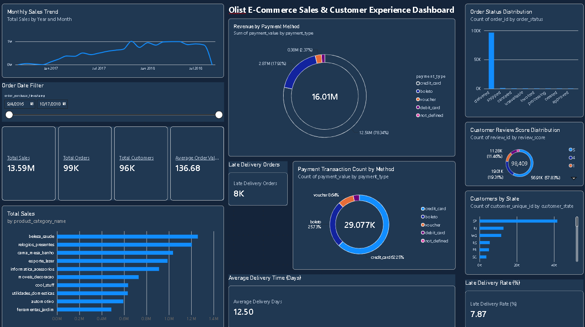

# Olist E-Commerce Sales & Customer Experience Analysis


## About the Project

This project is based on the Brazilian Olist e-commerce dataset. The main objective was to explore order and customer data, understand sales performance, and identify patterns related to payments, product categories, reviews, and delivery.

I used MySQL for querying and analyzing the datasets and Power BI to build a dashboard that brings the important metrics together.

## Tools Used

- MySQL Workbench
- SQL
- Microsoft Power BI
- Microsoft Excel

## Work Performed

**SQL Analysis**
- Explored and analyzed nine CSV datasets.
- Worked with joins to combine information from different tables.
- Created 15 SQL queries for business analysis.
- Used aggregate functions, subqueries, date functions, and conditional statements.
- Analyzed revenue, orders, customers, products, payments, and delivery performance.

**Power BI Dashboard**
- Connected MySQL database with Power BI.
- Created KPI cards for sales, orders, customers, and delivery metrics.
- Built charts for monthly sales, order status, payment methods, product categories, and customer reviews.
- Added date filtering to explore sales over different periods.
- Worked with table relationships and visual formatting.

## Key Findings

| Business Metric | Result |
|---|---:|
| Total Orders | 99,441 |
| Delivered Orders | 96,478 |
| Total Payment Revenue | R$16.01M |
| Average Order Value | R$160.99 |
| Average Delivery Time | 12.5 Days |
| Late Delivered Orders | 7,826 |
| Average Review Score | 4.09 / 5 |
| Repeat Customer Rate | 3.12% |

## Project Structure

```text
olist-customer-experience-analysis/
│
├── data/
│   └── raw/
│       └── Olist CSV datasets
│
├── sql/
│   └── olist_analysis.sql
│
├── powerbi/
│   └── Olist_Ecommerce_Sales_Customer_Experience_Analysis.pbix
├── screenshot/
│   └── olist-dashboard.png
│
└── README.md
```

## Challenges & Learning

One of the challenging parts was understanding how different tables were connected and making sure the relationships worked correctly in Power BI.

While working on this project, I got practical experience with SQL queries, relational data, business metrics, and dashboard development. I also learned how to turn query results into visual reports that are easier to understand.

## Author

**Akarsh Srivastava**

GitHub: https://github.com/Akarsh78

Project Repository: https://github.com/Akarsh78/olist-customer-experience-analysis
